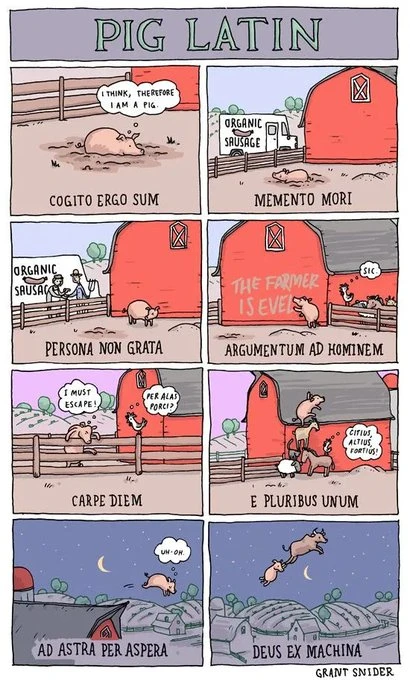

# Semana 14 · La letra chiquita

> **La pregunta de la semana:** ¿qué dice la letra chiquita?

**Esta semana podrás:**

- arrancar la unidad 3 sabiendo qué puertas vas a abrir y con qué suelo se cierra el semestre
- entender las frases latinas de los contratos, las leyes y las noticias, y detectar cuándo alguien las usa mal
- explicar por qué un chiste en latín da risa, que es la prueba de que entendiste la locución
- leer el Reglamento de Estudiantes que aceptaste al inscribirte, y saber qué firmaste
- cazar una locución en libertad y dictaminarla con el DLE enfrente
- dibujar una viñeta cuyo chiste solo funcione si sabes latín

Aquí empieza la unidad 3. El orden cambió un poco: en vez de abrir con el griego de los médicos, abrimos con el latín de los tribunales. El griego de la bata llega después, con la misma álgebra. El latín de hoy no está muerto: está escondido en la cláusula que firmas, en la noticia del juez y en la última viñeta de la tira que vas a ver el martes. Entender la letra chiquita es no firmar lo que no entiendes.

---

| Día | Sesión | Trae |
|---|---|---|
| [Martes](#martes) · 1 h | Un cerdo que habla latín | tu tecnicismo puente de la semana 12, sin buscar |
| [Miércoles](#miercoles) · 1 h | La letra chiquita | un papel de tu casa con latín adentro: recibo, contrato, reglamento; y tu mejor oración del 14A |
| [Jueves](#jueves) · 1 h, centro de cómputo | La cacería | tu mazo con las locuciones del taller |
| [Viernes](#viernes) · 2 h | El quiz #10 y la segunda temporada | plumones, hojas blancas y tu expediente al día |

Cada día es un mazo de láminas. En clase se proyectan una por una con el botón <strong>Presentar</strong>; aquí se quedan apiladas, en orden, para volver a ellas cuando quieras. Debajo de los mazos: la tira del cerdo con su crédito, la regla de oro de las locuciones, el gimnasio completo, la hoja de consulta para tocar y el muro con lo que el grupo cazó.

<!-- ============================ MARTES ============================ -->
<section class="mazo" id="martes">

Martes · 1 hora

<h3>Un cerdo que habla latín</h3>

Abre la unidad 3 y, de paso, descubre que ya entiendes latín: el chiste te lo va a demostrar.

<button class="btn-presentar" type="button">Presentar ▸</button>

<section class="lam">
<h4>1 El minuto del lector 3 min</h4>
Al aire

Una persona, un minuto: qué estoy leyendo y por dónde voy.

Empieza la tercera unidad y toca tercer libro. Si ya lo tienes, di cuál y quién te lo recomendó; si no, el tendedero de <a href="../leemos.html">Leemos</a> tiene fichas con dueño que presta. Así se contesta: «Voy en el segundo capítulo de <em>El principito</em>; me lo prestó Mariana del círculo y todavía no sé si me gusta.»

Antes, tu minuto con el ticket de la semana pasada en voz alta: lo turbio y qué haces hoy con eso. Luego el minuto del lector. Quien no tenga tercer libro sale hoy con uno apartado del tendedero: anota quién presta qué.

</section>
<section class="lam lam--bitacora">
<h4>La bitácora del lector 1 min</h4>

Nuevo libro, nueva tarjeta. Ábrela hoy y anota desde qué página arrancas.

<a href="../recursos/plantillas/bitacora-lector.html" target="_blank" rel="noopener">Bitácora del lector</a>La tarjeta del tercer libro se abre desde el menú. Y en <em>Mi rastro</em>, la constancia que vas a necesitar al cerrar la unidad.

Lámina fija de todos los martes: pasa el QR, manda el enlace al grupo en este momento y sigue. Recuérdales que la bitácora vive solo en su teléfono: desde el menú se copia un código de respaldo (empieza con ETIMB·) que se mandan a sí mismos por WhatsApp.

</section>
<section class="lam lam--oscura">
<h4>2 Aquí empieza la unidad 3 8 min</h4>

¿Qué puertas me abren las palabras?

Cuatro paradas y un Museo. Hoy abrimos la primera puerta, la del latín, y el orden del mapa cambió un poco.

<table>
<tr><th>Parada</th><th>Qué abre</th><th>Qué te llevas</th></tr>
<tr><td>La letra chiquita (esta semana)</td><td>el latín de los contratos, las leyes y las noticias</td><td>leer una cláusula sin que te la tengan que explicar, y corregir a quien diga "a grosso modo"</td></tr>
<tr><td>Entender a los médicos</td><td>el griego de la bata: órgano + padecimiento</td><td>traducir un diagnóstico al español de tu abuela</td></tr>
<tr><td>Mis raíces hablan inglés</td><td>el inglés de la universidad, hecho de tus mismas raíces</td><td>leer un resumen científico en inglés casi sin saber inglés</td></tr>
<tr><td>¿Quién decide qué palabras existen?</td><td>el oficio de las academias y el de los hablantes</td><td>el quiz y la defensa socrática: de ahí sale tu tercer parcial</td></tr>
<tr><td>El Museo</td><td>tus palabras del semestre, defendidas en público</td><td>la evidencia mayor de tu conversación final de diciembre</td></tr>
</table>

Las dos unidades anteriores preguntaban de dónde vienen las palabras. Esta pregunta para qué sirven: qué puertas abren. El suelo de la unidad 3, tal como está escrito en <a href="../evaluacion.html">Tu calificación</a>: quizzes intentados · portafolio del Museo completo con su bitácora · defensa socrática hecha · presencia en el tercer círculo · segundo booktuber entregado · defensa final del Museo, que es la única indelegable: el Museo se defiende en persona.

Di en una frase por qué empezamos por el latín y no por los médicos: el orden cambió, el camino no. Lee el suelo completo en voz alta, despacio, y aclara que la defensa socrática es el tercer peldaño de la escalera que empezó en la semana 7. Las fechas exactas de cada parada se anuncian al cerrar cada semana, no hoy.

</section>
<section class="lam">
<h4>3 La tarea puente 4 min</h4>
Al aire

El viernes de la 12 trajiste un tecnicismo sin buscar. Ronda rápida: ¿es médico, legal, científico, o trae latín?

Solo se dice la palabra y de dónde salió. Así se contesta: «<em>Habeas corpus</em>, lo oí en una noticia de un detenido y no supe qué era.» Los que traigan latín se quedan en esta semana; los médicos esperan su semana en una lista en el pizarrón. Nadie lo busca todavía.

Tres columnas en el pizarrón: médicos, legales, otros. Los de la columna legal son material de la hoja de consulta de esta semana y del taller del miércoles: anótalos tal cual los dijeron, con error y todo. Si alguien no trajo nada, le pides uno al vuelo: cualquier palabra de un contrato de celular sirve.

</section>
<section class="lam lam--actividad">
<h4>4 Un cerdo que habla latín 18 min</h4>
Equipos de tres · proyectado y en el celular

Ocho viñetas con el pie tapado. Ocho locuciones latinas. El chiste solo funciona si sabes cuál va en cada una.

La tira se llama <em>Pig Latin</em> y la dibujó Grant Snider: un cerdo en una granja, y en cada viñeta un pie en latín. En <a href="../ejercicios/semana-14/ejercicio-14D-el-cerdo-que-habla-latin.html">El cerdo que habla latín</a> los pies están tapados. Primero tres minutos en <em>Solo la locución</em>: con lo que sepan. Luego se cambia a <em>Con significados</em>, cada locución con su traducción, y ya no se trata de saber latín sino de entender el chiste: ¿qué está mirando el cerdo en la segunda viñeta? Cuando las ocho estén puestas, <strong>Revisar</strong> dice cuántas atinaron, sin decir cuáles.

<a href="../ejercicios/semana-14/ejercicio-14D-el-cerdo-que-habla-latin.html" target="_blank" rel="noopener">El cerdo que habla latín</a>Emparejamiento a ciegas con la tira de Grant Snider: dos niveles, el botón Revisar para los equipos y el botón Destapar para el profesor.

Proyecta en modo proyector y que cada equipo lo abra también en un celular. Tres minutos en nivel 2, luego cambia a nivel 1 y da seis más. Después, tú en el proyector: resuelve viñeta por viñeta preguntando «¿por qué da risa?» antes de poner cada locución, y solo al final tocas Destapar, que abre la explicación de cada chiste. Hay tres latines escondidos en los globos de la gallina: <em>sic</em>, <em>per alas porci</em> y <em>citius, altius, fortius</em>; deja que alguien los encuentre. Di el crédito en voz alta: Grant Snider, Incidental Comics.

</section>
<section class="lam">
<h4>5 ¿Por qué da risa? 5 min</h4>

Si entendiste el chiste, entendiste la locución. Esa es la prueba de esta semana.

Un cerdo mira una camioneta que dice «salchichas orgánicas». Sin el pie, es un cerdo mirando una camioneta. Con el pie, <em>memento mori</em>, es un cerdo mirando su propia muerte con ruedas. Una locución es una idea completa comprimida en dos o tres palabras, y quien no la tiene no ve el chiste. Tampoco entiende el contrato, ni la noticia, ni al abogado. El latín de esta semana no es cultura general: es una llave.

Pide dos o tres viñetas más explicadas por ellos, con la misma fórmula: qué se ve sin el pie, qué se ve con el pie. La de <em>deus ex machina</em> es la mejor para cerrar: el cerdo volando salvado por algo que no vimos venir, que es exactamente lo que significa.

</section>
<section class="lam">
<h4>6 Qué es una locución latina 4 min</h4>

Una frase hecha en latín que usamos tal cual, sin traducir, dos mil años después.

<!-- PENDIENTE DE ARTE: el prompt está en docente/imagenes-semana-14.md (lámina "la preposición venía por dentro"). Mientras no exista el archivo, la imagen se quita sola. -->

<table>
<tr><th>Regla</th><th>Ejemplo</th></tr>
<tr><td>Se escribe en cursiva y sin tilde, como lo que es: latín</td><td><em>motu proprio</em>, <em>statu quo</em>, <em>habeas corpus</em></td></tr>
<tr><td>Salvo las que ya se castellanizaron: esas llevan tilde y van en redonda</td><td>álter ego, vox pópuli, currículum, déficit</td></tr>
<tr><td>No le agregues preposición: el latín ya la traía por dentro</td><td><em>grosso modo</em>, no "a grosso modo"; <em>motu proprio</em>, no "de motu propio"</td></tr>
</table>

La tercera regla es la que explica casi todos los errores que vas a oír en tu vida. En latín, la terminación de la palabra hacía el trabajo que en español hace la preposición: <em>modo</em> ya quería decir "de modo", <em>motu</em> ya quería decir "por movimiento". Si le pones la preposición por fuera, la estás diciendo dos veces.

</section>
<section class="lam lam--actividad">
<h4>7 Gimnasio: el terreno de la abuela 15 min</h4>
Actividad · en parejas, en el celular

Una semana en la vida de Dani, de la prepa de Concá: un terreno en disputa, un primo detenido, un baile, un contrato y una asamblea. En cada escena hay una locución trabajando.

<a href="../ejercicios/semana-14/ejercicio-14E-el-terreno-de-la-abuela.html">El terreno de la abuela</a>: doce escenas en mensajes, papeles y pleitos. En unas falta la locución y la eliges; en otras ya está y dices qué significa ahí, en esa situación; en otras alguien la dice mal y la cazas. Cada respuesta explica por qué, y al final tienes las doce con lo que significaron en la historia. Son las mismas locuciones del cerdo y de la letra chiquita, pero ahora en tu mundo.

<a href="../ejercicios/semana-14/ejercicio-14E-el-terreno-de-la-abuela.html" target="_blank" rel="noopener">El terreno de la abuela</a>Doce escenas: pon la locución, di qué significa en contexto, o cázala mal dicha. Tres viñetas del cerdo abren como ejemplo.

En parejas, un celular, quince minutos; no se termina en clase y está bien: sigue en casa. La escena 3 (carpe diem y el parcial) conecta con el artículo 68 del reglamento que leen el miércoles: siémbrala. Al cerrar, una ronda rápida de la pregunta final: cuál de las doce les hubiera servido ya en algo real de su casa o de su pueblo. Esa respuesta es el insumo del miércoles. <a href="../ejercicios/semana-14/ejercicio-14A-bien-o-mal-dicho.html">¿Bien o mal dicho?</a> queda como gimnasio de casa y para quien termine antes el jueves.

</section>
<section class="lam">
<h4>8 Antes del miércoles 2 min</h4>
Para llevar a casa

Busca en tu casa un papel con latín adentro, y tráelo o tómale foto.

El contrato del celular, un recibo, el reglamento de la escuela, una credencial, un pagaré, la noticia de un juicio. Hay más latín en un cajón de tu casa del que crees. Si de plano no encuentras, trae la pregunta: ¿dónde se esconde?

</section>
</section>

<!-- ============================ MIÉRCOLES ============================ -->
<section class="mazo" id="miercoles">

Miércoles · 1 hora

<h3>La letra chiquita</h3>

El reglamento que aceptaste al inscribirte, una cláusula con cinco locuciones, las tres trampas que oirás toda tu vida y seis locuciones que pasan por tus manos.

<button class="btn-presentar" type="button">Presentar ▸</button>

<section class="lam">
<h4>1 Ritual: lo que encontraste en casa 5 min</h4>
Al aire

Una vuelta: dónde apareció el latín y qué decía.

Así se contesta: «En el contrato del celular, en la cláusula 14, dice que la empresa puede cambiar las tarifas <em>ipso facto</em>; mi mamá lo firmó sin leerlo.» Nadie explica todavía qué significa: hoy solo se enseña dónde estaba escondido.

Anota en el pizarrón cada locución que aparezca, con el documento al lado. Lo que salga aquí es tu mejor material: una cláusula real del grupo vale más que la de la siguiente lámina. Si alguien trae una, proyéctala con su permiso.

</section>
<section class="lam lam--oscura">
<h4>2 Lo que firmaste al inscribirte 8 min</h4>

Esto es letra chiquita de verdad: dos artículos del Reglamento de Estudiantes de la UAQ, el que aceptaste al inscribirte. Dilos en español de tu casa.

<!-- PENDIENTE DE ARTE: el prompt está en docente/imagenes-semana-14.md (lámina "la letra chiquita"). Mientras no exista el archivo, la imagen se quita sola. -->

<table>
<tr><th>Lo que dice</th><th>Lo que dice, en cristiano</th></tr>
<tr><td><em>Artículo 70.</em> Para tener derecho a presentar examen ordinario en una asignatura, se requiere: haber sido alumno debidamente inscrito en la asignatura durante el ciclo escolar; haber presentado el ochenta por ciento, como mínimo, de trabajos y/o prácticas señaladas por el programa; y tener un mínimo de ochenta por ciento de asistencias.</td><td>Si no entregas ocho de cada diez trabajos, o faltas a más de dos clases de cada diez, no tienes derecho al examen final. No es que lo repruebes: no lo presentas.</td></tr>
<tr><td><em>Artículo 68.</em> El alumno que hubiere dejado de presentar un examen parcial en tiempo y forma previamente establecidos, perderá el derecho a sustentarlo con posterioridad.</td><td>Si no llegas al parcial el día que tocaba, ya no lo puedes presentar después.</td></tr>
</table>

Dos cosas que notar. La primera: en las veintinueve páginas del Reglamento no hay una sola locución latina en cursiva, y aun así casi nadie lo ha leído completo, porque está escrito en latín disfrazado: <em>acreditar</em>, <em>sustentar</em>, <em>vigente</em>, <em>incurrir</em>, <em>exentar</em>, <em>cualesquiera</em>. Las palabras de poder no siempre vienen en cursiva. La segunda, para que la letra chiquita también juegue a tu favor: el <em>artículo 71</em> dice que exentas el ordinario con promedio de ocho en los parciales, y el <em>67</em>, que el maestro está obligado a tomar en cuenta tus trabajos para calificar cada parcial. Eso también lo firmaste, y conviene saberlo.

<a href="https://www.uaq.mx/leyes/Reglamento-EstudiantesUAQ.pdf" target="_blank" rel="noopener">El Reglamento de Estudiantes de la UAQ</a>Veintinueve páginas, aprobadas por el Consejo Universitario en 2007. Léelo con lupa: es tu contrato con la universidad.

Proyecta primero solo la columna izquierda y que la traduzcan ellos, artículo por artículo, antes de mostrar la derecha. La tecla A oculta el apoyo mientras tanto. Después pregunta quién lo había leído: casi nadie, y eso es la lección. Regresa a la idea de la página de inicio del curso: hay palabras que se usan para que no entiendas, y no hace falta que sean latín. Esta es la lámina más política de la semana; dale el tiempo.

</section>
<section class="lam">
<h4>3 Una cláusula con las cinco 6 min</h4>

Ahora sí, con latín en cursiva. Tradúcela al español de tu casa.

«Las partes conservan <em>ipso facto</em> el <em>statu quo</em> del inmueble; la entrega del depósito es condición <em>sine qua non</em>, y cualquier ajuste <em>ad hoc</em> se acordará <em>motu proprio</em> por ambas partes.»

En español de casa: «Desde este momento todo se queda como está; sin el depósito no hay trato; y si hay que cambiar algo para un caso concreto, lo deciden los dos por su propia voluntad.» Son cinco locuciones en dos renglones, armadas para esta clase con las que más aparecen en contratos de renta. Quien no tiene estas cinco llaves firma a ciegas, y eso no es un accidente.

Hazlo colectivo, locución por locución, y que la traducción la digan ellos antes de mostrar la tuya. Esta cláusula es inventada, y dilo: la del reglamento era real. Si alguien trajo de su casa un contrato con latín, cámbiala por el suyo.

</section>
<section class="lam">
<h4>4 Las tres trampas 6 min</h4>

Tres errores que vas a oír toda tu vida, y ahora ya sabes por qué están mal.

<table>
<tr><th>Se dice</th><th>Se dice bien</th><th>Por qué</th></tr>
<tr><td>"a grosso modo"</td><td><em>grosso modo</em></td><td><em>modo</em> ya significa "de modo": la preposición venía por dentro</td></tr>
<tr><td>"de motu propio"</td><td><em>motu proprio</em></td><td><em>motu</em> ya es "por movimiento", y <em>proprio</em> lleva dos erres</td></tr>
<tr><td>"status quo"</td><td><em>statu quo</em></td><td>la frase completa era <em>in statu quo ante</em>: "en el estado en que estaba antes"; <em>status</em> es otra forma de la misma palabra</td></tr>
</table>

Las tres caen por la misma razón: el latín no usaba preposiciones para todo, usaba terminaciones. Cuando tomamos la frase prestada, la terminación se vino con ella, y al agregarle la preposición en español la decimos dos veces. Entender eso vale más que memorizar las tres: ya puedes sospechar de cualquier locución que lleve "a" o "de" por delante.

Que las digan en voz alta, bien dichas, tres veces. Suena a escuela de antes y funciona: la forma correcta tiene que sonarles normal en la boca para que la equivocada les suene rara.

</section>
<section class="lam">
<h4>5 Trofeos en casa: la antología 3 min</h4>

La página 15 de la antología del curso explica las locuciones. Y en los ejemplos se le fueron tres. Encuéntralos.

<table>
<tr><th>Dice la antología</th><th>Qué se le fue</th></tr>
<tr><td>«Yo diría que son 10 perros a grosso modo»</td><td>sobra la «a»: <em>grosso modo</em></td></tr>
<tr><td>«Lo hice a motu proprio porque quería que fuera a mi voluntad»</td><td>sobra la «a»: <em>motu proprio</em>, y la propia antología lo advierte un renglón arriba</td></tr>
<tr><td>«El paciente sufre delírium trémends»</td><td>una letra de más: <em>delírium trémens</em></td></tr>
</table>

No es para burlarse del material: es la prueba de que estas trampas se le van a cualquiera, hasta a quien las está explicando. Por eso la regla de la semana es corregir la frase y no humillar a la persona. Y por eso se verifica en el DLE, no en la antología ni en el profesor.

Da un minuto para que los encuentren solos antes de mostrar la columna derecha. Si alguien pregunta por «ex profeso», que aparece en el ejemplo de <em>ex professo</em>: el DLE acepta <em>exprofeso</em> como adverbio castellanizado, así que ahí no hay trofeo, hay dos formas válidas. Buen momento para decir que el juez es el diccionario, no el que grita más fuerte.

</section>
<section class="lam lam--actividad">
<h4>6 Gimnasio: taller de locuciones 27 min</h4>
Actividad · individual, luego en equipo

Seis locuciones pasan por tus manos: significado, una oración tuya y el error fichado. De aquí salen tus tarjetas.

<a href="../ejercicios/semana-14/ejercicio-14B-taller-de-locuciones.html">Taller de locuciones</a>: para cada una eliges el significado y lo revisas, escribes una oración donde la uses bien en un contexto de tu vida (un chat, una queja, una promesa) y fichas el error a evitar. Al final de cada una, generas la tarjeta y la copias: frente y reverso listos para tu mazo. Última estación: la oración del equipo que mejor suene se entrega al cierre, y es insumo del jueves y del muro.

<a href="../ejercicios/semana-14/ejercicio-14B-taller-de-locuciones.html" target="_blank" rel="noopener">Taller de locuciones</a>Seis locuciones, tres pasos cada una y la tarjeta generada para el mazo.

Circula y lee oraciones. Lo que suele fallar: usan la locución como adorno sin que la frase la necesite. Pide la prueba del cerdo: si quito la locución, ¿la frase pierde algo? Si no pierde nada, está de adorno. Reserva cinco minutos al final para que cada equipo lea su oración elegida.

</section>
<section class="lam">
<h4>7 Antes del jueves y aviso del viernes 5 min</h4>
Para llevar a casa

Mañana salimos de cacería al centro de cómputo. Y el viernes dibujamos nuestra propia temporada de la tira.

Jueves: traes tu mazo con las locuciones del taller, porque vas a verificar cuatro en el DLE y a cazar una en libertad. Viernes: en equipos, una viñeta cuyo chiste solo funcione si sabes la locución, igual que el cerdo. Trae plumones y hojas blancas tamaño carta. El animal lo eligen ustedes.

Anuncia los equipos del viernes hoy, para que lleguen con quién dibuja decidido. Las viñetas sueltas del cerdo, en la hoja de consulta de esta página, sirven de modelo: que las vean una por una antes de dibujar.

</section>
</section>

<!-- ============================ JUEVES ============================ -->
<section class="mazo" id="jueves">

Jueves · 1 hora · centro de cómputo

<h3>La cacería</h3>

El latín anda suelto en noticias, contratos, memes y discursos. Hoy sales a cazarlo, con el DLE de juez.

<button class="btn-presentar" type="button">Presentar ▸</button>

<section class="lam">
<h4>1 Cómo va a estar 5 min</h4>

Dos misiones en una hora: verificar la forma correcta de cuatro locuciones, y cazar una usada de verdad allá afuera.

Todo en <a href="../ejercicios/semana-14/ejercicio-14C-cazadores-de-locuciones.html">Cazadores de locuciones</a>. La regla de la cacería: el hallazgo vale con evidencia. Anotas dónde apareció, citas cómo lo usaron y verificas la forma correcta en el DLE antes de dictaminar. El error de una figura pública es un trofeo, y se corrige con humor, no con soberbia.

<a href="../ejercicios/semana-14/ejercicio-14C-cazadores-de-locuciones.html" target="_blank" rel="noopener">Cazadores de locuciones</a>Las dos misiones, con captura generada para pegar en tu expediente y subir al muro.

Proyecta el ejercicio un minuto para que vean las dos misiones y el reloj: quince minutos la primera, veinticinco la segunda, diez de puesta en común. Quien termine antes abre el <a href="../ejercicios/semana-14/quiz-gimnasio-semana-14.html">quiz de gimnasio</a>.

</section>
<section class="lam lam--actividad">
<h4>2 Misión 1: la forma correcta, en el DLE 15 min</h4>
Individual · con el DLE abierto

Cuatro locuciones de tu mazo, buscadas en el DLE: cómo las escribe, si llevan tilde, si van en cursiva.

Hasta las frases latinas tienen norma, y el DLE es el juez. Fíjate en lo que no aparece: busca "a grosso modo" y mira qué te devuelve. Busca <em>statu quo</em> y luego "status quo". Sin esta verificación, tu cacería no tiene juez: no puedes dictaminar que alguien usó mal una locución si no sabes cuál es la forma buena.

El DLE trae las locuciones latinas dentro de la entrada de su primera palabra o como entrada propia: enséñales a buscar <em>motu proprio</em> y a leer la marca "loc. lat.". Que al menos una de las cuatro sea de las que se dicen mal.

</section>
<section class="lam lam--actividad">
<h4>3 Misión 2: la cacería 25 min</h4>
Individual o en pareja · internet abierto

Una locución latina usada de verdad: noticia, red social, contrato, meme, canción, discurso. Con cita, lugar y veredicto.

Busca donde el latín vive: notas de tribunales, columnas de opinión, comunicados de gobierno, letras de canciones, tatuajes de famosos. Documenta dónde apareció, cita cómo la usaron, di qué significa y dictamina: bien usada, mal usada (trofeo) o dudosa, para discutirla en la puesta en común. Si está mal, escribe la corrección. Genera la captura y cópiala.

Los trofeos más fáciles están en los discursos de políticos y en los titulares. Pide al menos una cacería "bien usada" por equipo también: el objetivo no es burlarse, es leer. Si alguien encuentra una locución que no está en la hoja de consulta, es la mejor noticia del día: va al muro con su significado verificado. Reto aparte para quien termine antes: abrir el <a href="https://www.uaq.mx/leyes/Reglamento-EstudiantesUAQ.pdf">Reglamento de Estudiantes</a> y buscar una sola locución latina en cursiva. No hay. Que lo comprueben: el latín del reglamento viene disfrazado de verbos.

</section>
<section class="lam">
<h4>4 Puesta en común: los trofeos 10 min</h4>
Al aire

Cada equipo, un hallazgo: dónde, cómo lo usaron, veredicto. Y al muro.

Así se contesta: «Un diputado dijo en tribuna "lo aprobamos de motu propio"; mal usada, es <em>motu proprio</em>, y el DLE lo confirma.» Los mejores hallazgos y los peores errores se suben al muro de esta página desde el formulario de <a href="#sube-tu-locucion-al-muro">Sube tu locución al muro</a>, con nombre de pila si lo das.

Lleva el reloj con la tecla T: un minuto por equipo. Las dudosas se discuten aquí, y si no se resuelven, se resuelven con el DLE proyectado en el momento. El formulario cae en la pestaña <em>general</em> del recolector: palomea los que suben y genera el bloque con el menú Cosecha para pegarlo en "Lo que produjimos", en la variable LOCUCIONES.

</section>
<section class="lam">
<h4>5 Lo que vi hoy 5 min</h4>
Al aire

Tres cosas que salieron bien en el grupo y una que hay que apretar.

Sin nombres. Y mañana: el quiz #10 de apertura, con apuesta; la segunda temporada de la tira, dibujada por ustedes; y la cosecha. Trae plumones, hojas blancas y tu expediente al día.

La que hay que apretar suele ser la verificación: dictaminan "mal usada" de oído, sin haber abierto el DLE. Nómbralo aquí y no en cada equipo. Recuérdales que la cacería es también evidencia para su tercer parcial: la captura va al expediente.

</section>
</section>

<!-- ============================ VIERNES ============================ -->
<section class="mazo" id="viernes" data-ticket>

Viernes · 2 horas

<h3>El quiz #10 y la segunda temporada</h3>

Abre la serie de la unidad 3 con apuesta, y luego dibuja una viñeta que solo entienda quien sepa latín.

<button class="btn-presentar" type="button">Presentar ▸</button>

<section class="lam lam--actividad">
<h4>1 Ritual: quiz relámpago #10 15 min</h4>
A solas · sin mazo y sin celular

Tres reactivos. Tu apuesta primero, del 0 al 3.

Traducir dos locuciones, corregir una que medio mundo dice mal, y leer una cláusula en español llano. En el cuadernillo, se califica en el momento, y los dos números van al renglón del <strong>quiz #10</strong> de tu expediente: el primero de la unidad 3.

<a href="../ejercicios/semana-14/quiz-relampago-semana-14.html" target="_blank" rel="noopener">El quiz, lámina por lámina</a>El mismo que se proyecta, con cronómetro de tres minutos y las respuestas al final.

Proyecta desde el enlace. Reparte: 2 min de apuesta, 3 de resolución, 8 de calificación comentada, 2 para el expediente. En el reactivo 2 hay dos errores y el "bien" exige cazar los dos. En el 3 vale cualquier redacción que traiga las tres ideas: como está, en el acto, sin eso no hay trato.

</section>
<section class="lam lam--oscura">
<h4>2 El renglón once 5 min</h4>

Diez renglones traías desde agosto. Hoy escribes el once, y ya con latín.

Abre tu serie de calibración y mira los dos números de hoy junto a los diez anteriores. La pregunta de esta unidad es si la brecha que cerraste en octubre se sostiene cuando cambia el material. Si tu apuesta y tu resultado se separaron otra vez, no es retroceso: es que el latín es terreno nuevo, y la calibración se vuelve a ganar en cada terreno.

Un minuto de silencio para que la miren. Dilo claro: el tercer parcial se propone con esta serie enfrente, como los dos anteriores, y los renglones de la unidad 3 empiezan hoy.

</section>
<section class="lam">
<h4>3 La frase que marqué 5 min</h4>
Al aire

Cuatro o cinco personas: la frase que marcaste esta semana en tu libro, leída tal cual, y por qué esa.

Así se contesta: «Marqué "nadie es profeta en su tierra" porque mi tía lo dice igualito y no sabía que venía de un libro.» Es la primera semana de la unidad, y es cuando más se cae la bitácora: cinco minutos de frases en voz alta la mantienen viva, y si tu libro trae latín escondido, mejor.

Elige a quienes no hablaron el martes. Anota qué libros suenan: esos nombres son los que mueven el tendedero. Si alguien no tiene frase, que anote hoy la primera, en la tarjeta nueva de su bitácora, y sigue.

</section>
<section class="lam lam--actividad">
<h4>4 Pig Latin, segunda temporada 48 min</h4>
Equipos de tres · plumones y hojas carta

Una viñeta por equipo. El chiste solo debe funcionar si sabes la locución que les tocó. El pie va aparte, tapado.

<table>
<tr><th>Momento</th><th>Minutos</th><th>Qué pasa</th></tr>
<tr><td><strong>El sorteo</strong></td><td>2</td><td>cada equipo saca una locución: motu proprio, grosso modo, habeas corpus, de facto, statu quo, sine qua non, modus operandi o in fraganti</td></tr>
<tr><td><strong>Dibujar</strong></td><td>18</td><td>una sola viñeta, hoja carta horizontal; el pie en una tira de papel aparte, doblada; nada de latín escrito dentro del dibujo</td></tr>
<tr><td><strong>La galería a ciegas</strong></td><td>15</td><td>las viñetas se pegan en la pared sin pie; cada equipo recorre con la lista de las ocho y anota cuál cree que va en cada una</td></tr>
<tr><td><strong>El destape</strong></td><td>10</td><td>se despliegan los pies, se cuentan los aciertos: gana la viñeta que más equipos adivinaron, porque ese es un buen chiste</td></tr>
<tr><td><strong>Las fotos</strong></td><td>3</td><td>las viñetas, con el permiso de sus autores, se suben a la galería de abajo: foto, locución y nombres</td></tr>
</table>

Las reglas del cerdo: el animal lo eligen ustedes, el chiste depende de la locución, y si al quitar el pie la viñeta sigue teniendo sentido, el chiste no está en el latín. No hace falta dibujar bien: hace falta que se entienda qué está mirando el personaje.

Sortea con papelitos; si hay más de ocho equipos, se repiten locuciones y mejor, porque se comparan dos chistes sobre la misma. Durante los veinte minutos de dibujo pasa por cada equipo con una sola pregunta: ¿qué ve quien no sabe la locución? Si contestan "lo mismo", el chiste todavía no existe. Las fotos se suben con nombre de pila y permiso explícito.

</section>
<section class="lam lam--actividad">
<h4>5 Al muro, a la galería y al mazo 15 min</h4>
Actividad · individual y por equipo

Tu locución cazada al muro, la viñeta de tu equipo a la galería, y tus tarjetas al mazo.

Abajo, en <a href="#sube-tu-locucion-al-muro">Sube tu locución al muro</a>, está el formulario de la cacería: la locución, dónde apareció con su cita, y tu veredicto con la corrección si la hubo. Un poco más abajo, <a href="#sube-la-vineta-de-tu-equipo">Sube la viñeta de tu equipo</a>: una persona por equipo sube la foto (a Drive o al grupo de WhatsApp, y pega el enlace), la locución y los nombres de quienes la dibujaron. El profesor revisa y publica, con nombre de pila si lo das. Y las tarjetas que generaste en el taller del miércoles van a tu mazo de Anki hoy, no el domingo: el mazo vivo es tabla del suelo.

<a href="../recursos/anki/etimologias-semana-14.apkg">Baja el mazo de la semana 14</a>Quince locuciones, con la trampa de cada una en la nota. En <a href="../recursos/anki.html">Recursos · Anki</a> está cómo entra al teléfono.

Quien no cazó nada el jueves caza ahora, con el celular: cinco minutos bastan para encontrar un "a grosso modo" en una red social. Las fotos: pide que las tomen de frente y con luz, sin el pie en la imagen; el pie va en el campo de la locución, y la galería lo tapa sola para que se pueda volver a jugar. El formulario cae en la pestaña <em>general</em> del recolector; el bloque se pega en la variable VINETAS.

</section>
<section class="lam">
<h4>6 La siguiente puerta 10 min</h4>
Para llevar a casa

Hoy abriste la del latín. Quedan tres puertas y el Museo.

<table>
<tr><th>Lo que falta de la unidad 3</th><th>Qué traes</th></tr>
<tr><td>Entender a los médicos: el griego de la bata</td><td>tu tecnicismo médico de la columna del martes, sin buscar</td></tr>
<tr><td>Mis raíces hablan inglés</td><td>un texto en inglés de tu carrera o de tu interés que no entiendas</td></tr>
<tr><td>¿Quién decide qué palabras existen?: quiz y defensa socrática</td><td>tu portafolio del Museo al día, porque de ahí sale el tercer parcial</td></tr>
<tr><td>El Museo, semana 17</td><td>tus palabras del semestre, listas para defenderse en público</td></tr>
</table>

El suelo de la unidad 3, otra vez, porque hoy ya tienes una tabla puesta: quizzes intentados (el #10 ya está), portafolio del Museo completo con su bitácora, defensa socrática, presencia en el tercer círculo, segundo booktuber y la defensa final del Museo. Tu portafolio es lo que más conviene revisar este fin de semana: cuántas piezas tienes y cuáles les falta ficha.

Anuncia aquí cuál parada sigue la semana que entra y qué traen el martes; la tabla no fija el orden a propósito. Recuerda el tercer círculo y el segundo booktuber: fechas en cuanto las tengas, y en la página de la semana que corresponda.

</section>
<section class="lam">
<h4>7 Cierra la semana 3 min</h4>

El martes viste un cerdo mirando una camioneta y no sabías por qué daba risa. Hoy lees la cláusula de un contrato sin que nadie te la explique.

Eso es lo que abre esta unidad: no de dónde vienen las palabras, sino qué puertas te abren. La del latín ya tiene tu llave. Trae la siguiente palabra que no entiendas, de donde sea, y la abrimos con las mismas herramientas.

</section>
</section>

## La lectura, esta semana

El **minuto del lector** abre el martes con el tercer libro en la mano, o con uno apartado del tendedero de [Leemos](../leemos.html). La tarjeta nueva de tu [bitácora](../recursos/plantillas/bitacora-lector.html) se abre esta semana. El tercer círculo y el segundo booktuber tienen fecha más adelante en la unidad; el booktuber se hace como el primero, con [Tu booktuber, paso a paso](../ejercicios/semana-09/booktuber-como-se-hace.html).

---

## Herramientas de la semana

### La tira del cerdo

*Pig Latin*, de Grant Snider ([Incidental Comics](https://www.incidentalcomics.com)). Ocho viñetas y ocho locuciones: *cogito ergo sum*, *memento mori*, *persona non grata*, *argumentum ad hominem*, *carpe diem*, *e pluribus unum*, *ad astra per aspera* y *deus ex machina*. Se proyecta en clase con fines didácticos; el original y el resto de su obra están en su sitio. El título es también un juego: *pig latin* es el nombre de un juego de palabras en inglés, el "idioma del cerdo".

Lo que la tira enseña, y por eso abre la semana: el chiste solo funciona si entiendes la locución. Tapar los pies y deducir cuál va en cada viñeta es exactamente el músculo que se entrena después con los contratos. En [El cerdo que habla latín](../ejercicios/semana-14/ejercicio-14D-el-cerdo-que-habla-latin.html) los pies vienen tapados. Las ocho viñetas también están sueltas, como ejemplo, en la hoja de consulta de abajo: toca una locución en rosa y aparece la suya.

### La regla de oro de las locuciones

En latín, la terminación de la palabra hacía el trabajo de la preposición. Por eso *grosso modo* ya significa "a grandes rasgos" sin ninguna "a", y *motu proprio* ya significa "por voluntad propia" sin ningún "de". Si le agregas la preposición por fuera, la estás diciendo dos veces. Sospecha de cualquier locución que oigas con "a" o "de" por delante, y verifica en el [DLE](https://dle.rae.es): las locuciones latinas aparecen con la marca *loc. lat.*, en cursiva y sin tilde. Las que ya se castellanizaron (álter ego, vox pópuli, currículum, déficit) llevan tilde y van en redonda.

### Lo que firmaste al inscribirte

El [Reglamento de Estudiantes de la UAQ](https://www.uaq.mx/leyes/Reglamento-EstudiantesUAQ.pdf) es el contrato que aceptaste al inscribirte: veintinueve páginas, aprobadas por el Consejo Universitario en 2007. No trae una sola locución latina en cursiva, y aun así casi nadie lo ha leído completo. Los artículos que más te tocan: el **70** (sin ochenta por ciento de trabajos y de asistencias no hay derecho a examen ordinario), el **68** (el parcial que no presentas el día que toca ya no se presenta), el **71** (con ocho de promedio en los parciales exentas el ordinario) y el **67** (el maestro debe tomar en cuenta tus trabajos para calificar cada parcial). El miércoles se leen dos de ellos en español llano; los otros dos conviene que los leas tú, con lupa.

### En el centro de cómputo (jueves)

1. Confirma en el [DLE](https://dle.rae.es) la forma correcta de 4 locuciones (cómo se escriben, si llevan tilde).
2. Caza una locución latina "en libertad": una noticia, un contrato, un meme, una canción. Documenta: dónde apareció, qué significa, si se usó bien o mal.
3. Los errores de figuras públicas son trofeos: captura y corrección, con humor y sin soberbia.

---

## El encargo de la unidad 2

Las preguntas 4 y 5 de la autoevaluación de la unidad 2 se entregan en [El encargo](../recursos/plantillas/autoevaluacion-u2.html): tu columna de opinión sobre algo que precisa mejorar en el campus, pasada por el editor de mesa antes de mandarla, y el número que crees merecer, con su porqué. La columna se comparte con el campus con la firma que elijas; el número solo lo lee el profesor.

---

## El gimnasio completo

Los ejercicios de esta semana, para tu celular o el centro de cómputo. Sin nota y sin registro: puro entrenamiento.

- [El cerdo que habla latín](../ejercicios/semana-14/ejercicio-14D-el-cerdo-que-habla-latin.html) · martes: la tira con los pies tapados, para emparejar a ciegas
- [El terreno de la abuela](../ejercicios/semana-14/ejercicio-14E-el-terreno-de-la-abuela.html) · martes: doce escenas de una historia donde pones la locución, dices qué significa ahí o la cazas mal dicha
- [¿Bien o mal dicho?](../ejercicios/semana-14/ejercicio-14A-bien-o-mal-dicho.html) · para la casa, y para quien termine antes el jueves
- [Taller de locuciones](../ejercicios/semana-14/ejercicio-14B-taller-de-locuciones.html) · miércoles
- [Cazadores de locuciones](../ejercicios/semana-14/ejercicio-14C-cazadores-de-locuciones.html) · jueves, centro de cómputo
- [Quiz de gimnasio](../ejercicios/semana-14/quiz-gimnasio-semana-14.html) · para ensayar cuando quieras

### El proyectable de la semana

- [El quiz relámpago #10, tal como se proyecta](../ejercicios/semana-14/quiz-relampago-semana-14.html) · viernes, con cronómetro y respuestas
- [El cerdo que habla latín](../ejercicios/semana-14/ejercicio-14D-el-cerdo-que-habla-latin.html) · martes en el proyector y en los celulares; el botón Destapar es del profesor

## Hoja de consulta

Toca una locución para ver qué significa y cómo se usa bien. Ojo con las que se dicen mal. Están las diecisiete de la antología del curso, las ocho de la tira (en rosa, con lo que pasa en su viñeta), los tres latines que dice la gallina y unas cuantas más que vas a oír en noticias y tribunales.

  

  
Toca una locución.

{: .ojo }
Tres errores que oirás toda tu vida: "a grosso modo", "de motu propio" y "status quo". Ahora ya sabes por qué están mal: el latín traía la preposición por dentro.

---

## Las tarjetas de la semana

Quince locuciones: las nueve de la letra chiquita, cuatro de la tira y dos más. Las del taller del miércoles las generas tú, con tu propia oración en el reverso; estas son las mínimas.

📥 **[Baja el mazo de la semana 14](../recursos/anki/etimologias-semana-14.apkg)** · Quince locuciones, con la trampa de cada una en la nota. En [Recursos · Anki](../recursos/anki.html) está el semestre completo.

| Frente | Reverso (significado · uso) |
|---|---|
| motu proprio | por voluntad propia · sin "de", con dos erres |
| grosso modo | a grandes rasgos · sin "a" |
| habeas corpus | derecho a no ser detenido sin causa |
| de facto | de hecho, en la práctica |
| statu quo | el estado actual · no "status quo" |
| ipso facto | en el acto |
| vox pópuli | lo que ya todos saben |
| sine qua non | condición indispensable |
| modus operandi | modo de actuar |
| memento mori | recuerda que vas a morir · el cerdo y la camioneta |
| persona non grata | persona no bienvenida · el granjero |
| argumentum ad hominem | atacar a la persona, no al argumento · el grafiti |
| deus ex machina | la salida que aparece de la nada · el cerdo volando |
| in fraganti | en el momento justo del hecho |
| carpe diem | aprovecha el día · per alas porci? |

## Lo que produjimos

Las locuciones cazadas en el mundo real, con su veredicto y su corrección, y las viñetas de la segunda temporada dibujadas por el grupo. Se publican con nombre de pila y permiso de sus autores.

### Sube tu locución al muro

<!-- COSECHA:general (locuciones) · el bloque de abajo lo genera la hoja de cálculo del curso
     (pestaña general → menú Cosecha → Bloque para la web). Pega aquí lo que te dé,
     con el nombre de variable LOCUCIONES. Cada caso: palabra (la locución), historia
     (dónde apareció y la cita), fuente (veredicto y corrección) y nombre.
     Comentarios solo entre barra-asterisco. -->

<!-- /COSECHA -->

### Las viñetas del grupo

La segunda temporada, dibujada el viernes. Cada viñeta cuelga con el pie tapado, para que quien llegue pueda jugar: toca el pie y se destapa. Con el nombre de pila de quienes la dibujaron.

#### Sube la viñeta de tu equipo

<!-- COSECHA:general (viñetas) · el bloque de abajo lo genera la hoja de cálculo del curso
     (pestaña general → menú Cosecha → Bloque para la web). Pega aquí lo que te dé,
     con el nombre de variable VINETAS. Cada viñeta: palabra (la locución), historia
     (el enlace a la foto; si la foto se sube al repo, la ruta ../assets/img/semana-14/vinetas/...),
     fuente (quiénes la dibujaron) y nombre. Comentarios solo entre barra-asterisco. -->

<!-- /COSECHA -->

<button type="button" id="vin-todas">Destapar todas</button>

## El postre 🍨

*et cetera* es latín: "y lo demás". Cuando escribes "etc." estás abreviando una frase latina de hace dos mil años sin darte cuenta. También *versus* (contra), *alias* (de otro nombre) y *currículum* (lo que se ha corrido, la carrera). Y *sic*, la palabrita que dice la gallina frente al grafiti: significa "así", y se pone entre corchetes para avisar que el error ya venía en el original. Hablas más latín del que crees.

---

## Antes de irte

<a class="ticket" href="{{ site.ticket_url }}" target="_blank" rel="noopener">
  <b>Ticket de salida de esta semana</b>
  Noventa segundos, al cierre de la sesión larga: qué te llevas, qué quedó turbio y cómo estuvo el ritmo. Con nombre o sin él.
  <em>Lo que escribas aquí decide por dónde sigue la unidad 3.</em>
</a>
<a class="ticket-qr" href="{{ site.ticket_url }}" target="_blank" rel="noopener">
  
  escanéalo
</a>

