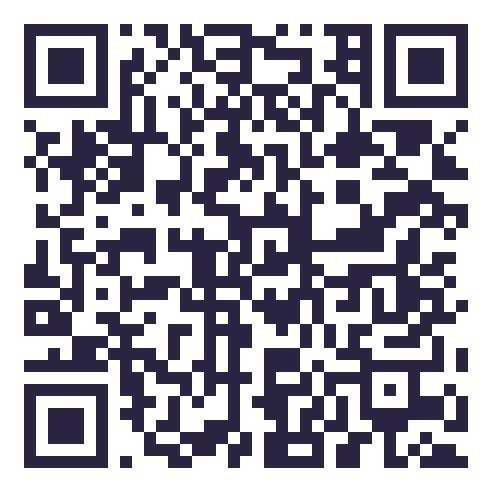
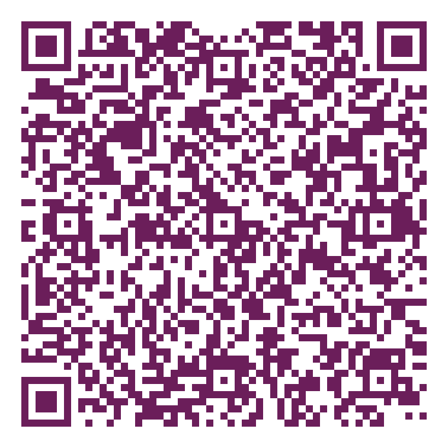

# Semana 16 · Quién decide qué palabras existen

> **La pregunta de la semana:** ¿quién decide qué palabras existen?

**Esta semana podrás:**

- explicar quién decide qué palabras existen, con el diccionario que acaba de salir como caso
- reconocer las seis maneras en que nace una palabra
- bautizar algo que no tiene nombre con piezas griegas o latinas verificadas, levantarle su acta y conseguirle testigos
- dictaminar como una academia si una palabra de la calle merece entrar al diccionario
- defender tu palabra en una mesa socrática, dudando en voz alta si hace falta
- cerrar la unidad con el integrador, el tercer círculo y tu tercer parcial

El viernes 30 de octubre salió el diccionario nuevo: 99 990 artículos y cerca de cinco mil novedades, entre ellas *porfa* y *cumple*. Nadie votó para que existieran: ya las decía todo el mundo. Esta semana averiguas quién manda en las palabras, bautizas una, le consigues testigos y la defiendes en una mesa donde nadie te examina: te ayudan a darla a luz.

---

| Día | Sesión | Trae |
|---|---|---|
| [Martes 17](#martes) · 1 h | El Registro Civil de las palabras | tu libro, y algo de tu vida que no tenga nombre |
| [Miércoles 18](#miercoles) · 1 h | La Academia y la partera | tu palabra y tus primeros testigos anotados |
| [Jueves 19](#jueves) · 1 h, centro de cómputo | La Academia en sesión | tu acta y tus testigos |
| [Viernes 20](#viernes) · 2 h | El cierre | tu libro, tu bitácora y tu expediente al día |

Cada día es un mazo de láminas. En clase se proyectan una por una con el botón <strong>Presentar</strong>; aquí se quedan apiladas, en orden, para volver a ellas cuando quieras. Debajo de los mazos: las seis maneras de nacer, diez huecos que alguien ya bautizó, las reglas de tu palabra, cómo es la mesa socrática, tu tercer parcial, el gimnasio completo y la hoja de consulta para tocar.

<!-- ============================ MARTES ============================ -->
<section class="mazo" id="martes">

Martes 17 de noviembre · 1 hora

<h3>El Registro Civil de las palabras</h3>

El diccionario no hace nacer las palabras: les levanta el acta.

<button class="btn-presentar" type="button">Presentar ▸</button>

<section class="lam">
<h4>1 El minuto del lector 3 min</h4>
Al aire

Una persona, un minuto: qué estás leyendo y por dónde vas.

El viernes es el tercer círculo, el del balance. Trae el libro que te llevas del semestre, aunque no lo hayas terminado: contar por qué un libro no te agarró también es balance.

Antes, tu minuto con lo turbio del último ticket de salida y qué haces hoy con eso. Luego el minuto del lector, con corte a los sesenta segundos.

</section>
<section class="lam lam--bitacora">
<h4>La bitácora del lector 1 min</h4>

El viernes es el círculo del balance. La tarjeta del tercer círculo trae tu testamento lector.

<a href="../recursos/plantillas/bitacora-lector.html" target="_blank" rel="noopener">Bitácora del lector</a>En el tercer círculo vive tu testamento lector, con su botón para mandarlo a Leemos. Y en <em>Mi rastro</em>, la constancia que vas a necesitar para tu tercer parcial.

Lámina fija de los martes: pasa el QR, manda el enlace al grupo y sigue. El testamento se escribe el viernes; hoy basta con que sepan dónde está.

</section>
<section class="lam lam--oscura">
<h4>2 La noticia 6 min</h4>

porfa

El 30 de octubre, <em>porfa</em> entró al diccionario. ¿Quién decidió que existiera?

Apuesta a mano alzada: la Real Academia, en Madrid; las veintitrés academias de la lengua; la gente que la dice; o nadie, porque ya existía. Ese viernes se presentó la 24.ª edición del <em>Diccionario de la lengua española</em>, doce años después de la anterior: 99 990 artículos y cerca de cinco mil novedades. Entraron también <em>cumple</em>, <em>IA</em>, <em>influencer</em>, <em>pódcast</em>, <em>autocorrector</em> y dos mexicanas: <em>acitronar</em> (lo que le haces a la cebolla a fuego lento hasta que se pone transparente) y <em>asegunes</em> (los peros de una propuesta).

<a href="../ejercicios/semana-16/quien-decide-que-palabras-existen.html" target="_blank" rel="noopener">¿Quién decide qué palabras existen?</a>El proyectable de hoy: la noticia, el Registro Civil, seis maneras de nacer y la regla que la gente rompió. La tecla R revela las apuestas.

Que voten antes de revelar. La respuesta honesta es la tercera con un pedazo de la cuarta: la gente la hizo y las academias le levantaron el acta. Revela con la frase del director de la RAE, que está en el proyectable: «el vocabulario crece o varía por obra de los hablantes». Si preguntan por qué tarda tanto: cerca de dos años de estudio por palabra, y esta vez doce años entre ediciones.

</section>
<section class="lam">
<h4>3 El Registro Civil 6 min</h4>

El diccionario no da a luz palabras: les levanta el acta cuando ya caminan.

El acta de nacimiento no hace al niño; el diccionario tampoco hace a la palabra. La registra cuando ya vive en la boca de la gente, y por eso siempre llega tarde. Se puede vivir sin acta: el olor de la tierra seca cuando le cae la primera lluvia se llama <em>petricor</em> desde 1964, cuando lo bautizaron dos científicos australianos, y la RAE lo tenía en su Observatorio de palabras, «en estudio». Y también hay acta de defunción: cuando nadie dice ya una palabra, el pleno de la Academia vota su salida.

<strong>Pregunta al aire:</strong> ¿qué palabra de tu casa vive sin acta?

Las respuestas de casa son oro: palabras de la abuela, del rancho, del camión. No las corrijas; anótalas en el pizarrón con la etiqueta «sin acta». Si alguien pregunta si petricor ya entró al diccionario nuevo, devuélvele la pregunta para el jueves: lo verifica en vivo en el centro de cómputo.

</section>
<section class="lam lam--actividad">
<h4>4 Seis maneras de nacer 12 min</h4>
Actividad · en parejas

Una palabra nace de seis maneras. Nueve recién nacidas: ¿cómo nació cada una?

<table>
<tr><th>Manera</th><th>Qué pasa</th><th>Ejemplo</th></tr>
<tr><td><strong>Composición culta</strong></td><td>se juntan piezas griegas o latinas</td><td>teléfono, fotografía</td></tr>
<tr><td><strong>Derivación</strong></td><td>a una palabra se le pega un prefijo o un sufijo</td><td>futbolista (de futbol)</td></tr>
<tr><td><strong>Acortamiento</strong></td><td>se le corta un pedazo</td><td>bici, cine, profe</td></tr>
<tr><td><strong>Sigla</strong></td><td>se juntan las iniciales</td><td>ONU, CEO</td></tr>
<tr><td><strong>Préstamo</strong></td><td>se toma de otra lengua</td><td>coche (del húngaro), futbol (del inglés)</td></tr>
<tr><td><strong>Cambio de sentido</strong></td><td>una palabra vieja estrena significado</td><td>ratón (el de la computadora)</td></tr>
</table>

En parejas, clasifiquen las nueve del proyectable antes de destaparlas: <em>porfa</em>, <em>cumple</em>, <em>IA</em>, <em>loguearse</em>, <em>cantinflear</em>, <em>streaming</em>, <em>brutal</em>, <em>dinosaurio</em> y <em>ecoansiedad</em>. Ojo: una palabra puede nacer de dos maneras a la vez.

<a href="../ejercicios/semana-16/quien-decide-que-palabras-existen.html" target="_blank" rel="noopener">¿Quién decide qué palabras existen?</a>Las nueve, una por lámina, con su apuesta y su revelación.

Claves: porfa y cumple, acortamiento; IA, sigla; loguearse, préstamo y derivación a la vez (del inglés log in, más -ear); cantinflear, derivación sobre un nombre propio (el DLE registra al menos ocho palabras de la familia de Cantinflas: cantinflas, cantinflada, cantinfleo, acantinflado, cantinflesco, acantinflarse, cantinflero y la propia cantinflear); streaming, préstamo sin adaptar; brutal, cambio de sentido (el diccionario le sumó en diciembre de 2025 el de 'magnífico'); dinosaurio, composición culta con dos piezas griegas; ecoansiedad, composición con una pieza griega y una latina, que es el puente a la lámina que sigue.

</section>
<section class="lam lam--oscura">
<h4>5 La regla que la gente rompió 6 min</h4>

«No mezcles griego con latín», dicen los manuales. La gente mezcla, y las palabras viven.

neo-<small>griego · nuevo</small>
natus<small>latín · nacido</small>
= neonato

El DLE arma <em>neonato</em>, 'recién nacido', con el griego <em>neo-</em> y el latín <em>natus</em>. La palabra con que los hospitales nombran a los recién nacidos rompe la regla, y nadie la saca del idioma. No está sola: <em>televisión</em> junta el griego <em>tele-</em>, 'a distancia', con el latín <em>visión</em>; <em>automóvil</em>, el griego <em>auto-</em>, 'por uno mismo', con el latín <em>móvil</em>; <em>tiranosaurio</em>, el latín <em>tyrannus</em> con el griego <em>saûros</em>, 'lagarto'.

<strong>Pregunta al aire:</strong> si la regla se rompe y la palabra vive, ¿quién tenía razón, la regla o la gente?

No cierres la pregunta: vuelve el miércoles en la Academia y en las mesas. Dato para ti: según el DLE, televisión llegó del inglés television y neonato del latín científico neonatus; la mezcla la hizo gente que necesitaba nombrar un invento o un bebé, y el español la adoptó. Desde hoy, mezclar se vale en su palabra, siempre que lo hagan a sabiendas y lo puedan defender.

</section>
<section class="lam">
<h4>Diez huecos que alguien ya bautizó 10 min</h4>
Al aire

Mira a quien trae la mochila. ¿De qué se acaba de dar cuenta?

Eso que sintió no tenía nombre hasta que John Koenig le puso uno: <em>sonder</em>, caer en la cuenta de que cada desconocido lleva una vida tan llena como la tuya. Koenig pasó doce años buscando sentimientos sin nombre y bautizándolos con piezas del griego, del latín y del francés. Hoy ves diez: cinco con un dibujo y cinco con un texto corto. En cada una apuestas primero qué hueco nombra y cómo lo llamarías tú. Ninguna tiene acta en el diccionario; viven de que la gente las usa.

<a href="../ejercicios/semana-16/diez-huecos-que-alguien-ya-bautizo.html" target="_blank" rel="noopener">Diez huecos que alguien ya bautizó</a>Diez palabras para lo que ya sentías: primero el dibujo o el texto, tu apuesta, y con la tecla R, la palabra con sus piezas.

Va antes del gimnasio a propósito: primero ven diez huecos ya bautizados y luego buscan el suyo. Un minuto por palabra. En las de texto, lee tú en voz alta y deja tres segundos de silencio antes de preguntar. Si el tiempo aprieta, proyecta sonder, kenopsia, jouska y exulansis, y deja las demás para la página. No pidas que cuenten nada personal: basta con mano arriba de «a mí me ha pasado».

</section>
<section class="lam lam--actividad">
<h4>6 Gimnasio: el acta de nacimiento 20 min</h4>
Actividad · individual

Busca un hueco: algo de tu vida que no tiene nombre. Bautízalo con piezas reales.

<a href="../ejercicios/semana-16/ejercicio-16A-acta-de-nacimiento.html">El acta de nacimiento</a>: eliges el hueco (algo del camión, del campus, del cerro, de tu casa), revisas que no tenga ya nombre, escoges piezas griegas o latinas de un banco y verificas cada una en el DLE, las pegas, defines tu palabra como lo haría el diccionario y escribes un ejemplo. Al final apuestas cuántos testigos tendrá el viernes, de 0 a 5. El acta se arma sola, y la mandas al Registro Civil del grupo desde ahí mismo.

<a href="../ejercicios/semana-16/ejercicio-16A-acta-de-nacimiento.html" target="_blank" rel="noopener">El acta de nacimiento</a>El hueco, las piezas verificadas, la definición, el ejemplo, tu apuesta y el acta lista para mandar.

Circula. La falla más común son piezas que no existen o significados de memoria: pide que te enseñen en el celular la entrada del DLE de cada pieza. La segunda es -fobia: el DLE no dice 'miedo', dice 'aversión' o 'rechazo', y vale más que lo descubran solos. Si alguien mezcla griego con latín, no lo corrijas: pregúntale si fue a propósito, porque esa respuesta es el ensayo de su mesa. Si alguien elige un hueco que se burla de una persona, reoriéntalo en privado.

</section>
<section class="lam">
<h4>7 Suelta tu palabra 4 min</h4>
Para llevar a casa

Tu palabra existe el día que alguien más la usa sin que se lo pidas.

<table>
<tr><th>Las cuatro reglas del testigo</th></tr>
<tr><td>Úsala sin explicarla, como si siempre hubiera existido.</td></tr>
<tr><td>Testigo es quien la dice sin que se lo pidas. Rogar no cuenta, y pagar menos.</td></tr>
<tr><td>Anota quién (nombre de pila o parentesco, nunca apellido), dónde y cuándo.</td></tr>
<tr><td>Ninguna palabra para burlarte de alguien.</td></tr>
</table>

Suéltala en tu casa, en el chat, en el camión. La más difícil de ganar es la de la casa, y la que más vale. El viernes el Registro Civil abre sus libros: ahí se sabe qué palabras nacieron de verdad.

Insiste en la regla de rogar: un testigo comprado no cuenta, y lo saben. Si preguntan cuántos testigos hacen falta, la respuesta es la de la semana: uno basta para que una palabra empiece a existir.

</section>
</section>

<!-- ============================ MIÉRCOLES ============================ -->
<section class="mazo" id="miercoles">

Miércoles 18 de noviembre · 1 hora

<h3>La Academia y la partera</h3>

Quién levanta las actas, y cómo se ayuda a nacer lo que sabes.

<button class="btn-presentar" type="button">Presentar ▸</button>

<section class="lam">
<h4>1 ¿Ya hay testigos? 3 min</h4>
Al aire

Mano arriba quien ya tenga un testigo.

Dos historias: dónde la soltaste y quién la repitió. Si nadie tiene, no pasa nada: casi ninguna palabra sobrevive su primera semana. Por eso pesan tanto las que sí.

Celebra el primer testigo como noticia de primera plana. Si alguien confiesa que rogó, ríete con él y recuérdale la regla.

</section>
<section class="lam lam--oscura">
<h4>2 La Academia por dentro 6 min</h4>

Ñ

Cuarenta y seis sillas con una letra cada una, un pleno todos los jueves, y una letra que nunca ha tenido silla.

En la Real Academia Española cada académico ocupa una silla marcada con una letra mayúscula o minúscula, y el pleno se reúne todos los jueves. Antes, las comisiones preparan las propuestas, y las veintitrés academias de la lengua revisan lo que les toca. Una palabra pasa cerca de dos años en estudio, y la Academia procura no registrar modas de paso. Las propuestas pueden llegar de instituciones, de especialistas o de cualquier ciudadano. Ocho letras nunca han tenido silla, y una de ellas es la Ñ.

Fuentes: la RAE, en Bienvenidos a la Real Academia y en Los académicos. Las ocho letras sin silla son v, w, x, y, z, Ñ, W e Y. Lo de las propuestas ciudadanas lo dijo la responsable del Instituto de Lexicografía en diciembre de 2025, y lo de los dos años, el director, en 2023.

</section>
<section class="lam lam--actividad">
<h4>La Academia del salón 1 min</h4>
Todo el grupo

Desde hoy este salón es una academia. Saca tu letra.

Cada quien saca una letra al azar: esa es tu silla hasta el viernes, y la escribes en la esquina de tu acta. La Ñ no se sortea: el viernes se la gana la palabra con más testigos.

Lleva las letras en papelitos, mayúsculas y minúsculas, sin la Ñ. Es juego, no evaluación: sirve para que el viernes la votación tenga ceremonia.

</section>
<section class="lam">
<h4>3 La mayéutica 5 min</h4>

mayéutica

El oficio de la partera: ayudar a dar a luz lo que el otro lleva dentro.

El DLE la trae del griego <em>maieutikós</em>, 'perito en partos', y <em>maieutikḗ</em>, 'técnica de asistir en los partos'. En el <em>Teeteto</em> de Platón, Sócrates cuenta que su madre era partera y que él ejerce el mismo oficio, pero con las ideas: no da a luz las suyas, ayuda a que el otro dé a luz las propias, y luego revisa si lo que nació está vivo. Eso va a pasar en tu mesa. El profe no examina: pregunta para que salga lo que ya sabes de tu palabra.

Lee en voz alta la definición del DLE y detente en su final: nociones que en el discípulo «estaban latentes». Esa es la promesa de la mesa: nadie les va a preguntar lo que no saben, sino lo que no saben que saben.

</section>
<section class="lam">
<h4>Qué cambia en tu mesa 2 min</h4>

Sin banco de preguntas. El profe pregunta desde lo que digas, y tus compañeros de mesa también.

<table>
<tr><th>Así es la mesa</th><th>Se evalúa</th><th>No se evalúa</th></tr>
<tr><td>Tres estudiantes, catorce minutos: un minuto para presentar tu palabra con tu acta, diez de diálogo cruzado, uno de retro.</td><td>Anatomía, fuente, criterio y honestidad: los cuatro de la rúbrica.</td><td>Que no te pongas nervioso, que hables como orador, que tu palabra tenga testigos.</td></tr>
</table>

Dudar en voz alta está permitido, y casi siempre es lo mejor que puedes hacer. La rúbrica completa, con lo que expresamente no se evalúa, está en <a href="../recursos/plantillas/rubrica-defensas.html">La rúbrica de las defensas</a>.

Lee en voz alta la columna de lo que no se evalúa. Que los testigos no cuenten en la mesa baja nervios: son del experimento, no de la defensa.

</section>
<section class="lam lam--actividad">
<h4>4 El profe en el banquillo 11 min</h4>
Todo el grupo · hoy Sócrates eres tú

El profe trae su palabra recién nacida. Ustedes preguntan.

Seis a ocho preguntas, de quien quiera. Pregunten lo que de verdad les dé curiosidad o les parezca flojo: por qué esas piezas, si ya existía otra palabra para eso, qué pasa si nadie la usa. Al final, la pregunta más útil de todas: ¿cuál lo puso en aprietos, y por qué?

Trae tu palabra con su acta; en tu banco privado hay dos propuestas listas. Contesta de verdad y deja que te vean dudar: «no sé, pero lo verificaría en…», «me corrijo», «déjame pensarlo en voz alta». En el cierre, que el grupo nombre las familias de preguntas que salieron y escríbelas en el pizarrón con sus palabras: casi siempre aparecen las cuatro de la rúbrica.

</section>
<section class="lam">
<h4>5 El sorteo de las mesas 2 min</h4>

Ocho mesas: dos hoy, cuatro mañana, dos el viernes.

Siete mesas de tres y una de cuatro. Primero los voluntarios; el resto, por sorteo. Mientras una mesa defiende, los demás trabajan en lo suyo.

Proyecta la lista y no la cambies después: la certidumbre baja nervios. La mesa de cuatro va el viernes al final y recoge a quien falte.

</section>
<section class="lam lam--actividad">
<h4>6 Mesas 1 y 2 28 min</h4>
Dos pistas a la vez

Dos mesas defienden. El resto: la Academia sesiona.

Si no te toca hoy, abre <a href="../ejercicios/semana-16/ejercicio-16B-la-academia-sesiona.html">La Academia sesiona</a> con tu comisión y dictaminen sus primeras palabras. Si tu mesa es mañana o el viernes, entrena diez minutos con el <a href="../ejercicios/semana-16/ejercicio-16C-entrenador-socratico.html">Entrenador socrático</a>. Y dale sus diez minutos al mazo.

<a href="../ejercicios/semana-16/ejercicio-16B-la-academia-sesiona.html" target="_blank" rel="noopener">La Academia sesiona</a>Cuatro palabras por comisión, el acta en el DLE de hoy, los cuatro filtros y el veredicto.

<a href="../ejercicios/semana-16/ejercicio-16C-entrenador-socratico.html" target="_blank" rel="noopener">Entrenador socrático</a>Las cinco familias de preguntas, la ruleta, el modo en pareja y las frases de rescate.

Catorce minutos por mesa: un minuto por presentación, diez de diálogo, uno de retro en la hoja de la rúbrica. Cruza las palabras de la mesa entre sí: eso vuelve socrática la conversación. El banco de preguntas está en tu material privado.

</section>
<section class="lam">
<h4>7 Antes del jueves 2 min</h4>
Para llevar a casa

Mañana, en cómputo, la Academia verifica en vivo. Trae tu acta y tus testigos.

Con el DLE abierto vas a comprobar si ya tienen acta palabras como <em>acitronar</em>, <em>asegunes</em> o <em>petricor</em>. Y si no mandaste tu acta el martes, mañana la mandas con los testigos que lleves.

</section>
</section>

<!-- ============================ JUEVES ============================ -->
<section class="mazo" id="jueves">

Jueves 19 de noviembre · 1 hora · centro de cómputo

<h3>La Academia en sesión</h3>

Cuatro mesas defienden; el resto dictamina con el diccionario abierto.

<button class="btn-presentar" type="button">Presentar ▸</button>

<section class="lam">
<h4>1 Cómo va a estar 2 min</h4>

Dos pistas: cuatro mesas en la esquina y la Academia en las computadoras.

<table>
<tr><th>Pista</th><th>Quién</th><th>Qué</th></tr>
<tr><td><strong>Las mesas 3 a 6</strong></td><td>los de la lista de hoy</td><td>defienden, catorce minutos por mesa</td></tr>
<tr><td><strong>La Academia</strong></td><td>todos los demás</td><td>dictaminan con el DLE abierto y mandan su dictamen al muro</td></tr>
<tr><td><strong>Al terminar</strong></td><td>quien acabe</td><td>manda o actualiza su acta, y diez minutos de mazo</td></tr>
</table>

Lee la tabla y siéntate con la mesa 3 de inmediato. Si una mesa se alarga, la 6 pasa al viernes.

</section>
<section class="lam lam--actividad">
<h4>2 La Academia sesiona 56 min</h4>
Por comisiones · centro de cómputo

¿Ya tienen acta? Verifícalo tú, en el DLE de hoy.

Tu comisión recibe cuatro palabras en <a href="../ejercicios/semana-16/ejercicio-16B-la-academia-sesiona.html">La Academia sesiona</a>. Dos son de las recién registradas o en estudio, y se buscan en el DLE en línea: ¿ya tienen acta? Dos andan en la calle, en el chat o en el juego, y se dictaminan con los cuatro filtros: uso, tiempo, necesidad y forma. Veredicto: entra, en observación o no entra, con un argumento. Y si una ya tenía acta, la pregunta cambia: ¿la Academia hizo bien? Se vale responder «sí, con asegunes».

<a href="../ejercicios/semana-16/ejercicio-16B-la-academia-sesiona.html" target="_blank" rel="noopener">La Academia sesiona</a>Las palabras de tu comisión, los cuatro filtros, el veredicto y el botón para mandarlo al muro.

<a href="../vitrina/palabras-recien-nacidas.html" target="_blank" rel="noopener">Palabras recién nacidas</a>La vitrina del grupo: el Registro Civil con sus actas y testigos, y el muro de los dictámenes.

Mientras tú estás en las mesas, la Academia trabaja sola: el ejercicio trae todo. Si una comisión descubre que petricor ya entró al diccionario nuevo, que lo anuncie en voz alta: lo descubrió ella. Los dictámenes caen en la pestaña general del recolector; las actas y los testigos, en la pestaña neologismo.

</section>
<section class="lam">
<h4>3 Lo que vi hoy 2 min</h4>

Una cosa que vi hoy en las mesas, sin nombres.

Una observación general, la más útil para quienes defienden el viernes. Casi siempre es la fuente («lo busqué», sin decir dónde) o la pieza que no saben explicar.

</section>
</section>

<!-- ============================ VIERNES ============================ -->
<section class="mazo" id="viernes" data-ticket>

Viernes 20 de noviembre · 2 horas

<h3>El cierre</h3>

El integrador, las últimas mesas, el círculo del balance y quién nació de verdad.

<button class="btn-presentar" type="button">Presentar ▸</button>

<section class="lam lam--actividad">
<h4>1 Ritual: el integrador 35 min</h4>
Individual · en papel

Diez reactivos, una apuesta, y cada uno en bien o aún no.

Primero apuestas cuántos vas a tener bien, de 0 a 9: el décimo es tuyo y no tiene respuesta correcta. Luego veintidós minutos para resolver y diez para calificarte tú, bloque por bloque, con las respuestas en pantalla. Lo que quede en aún no se reintenta, y cuenta tu versión más reciente.

<a href="../ejercicios/semana-16/quiz-integrador-u3-semana-16.html" target="_blank" rel="noopener">El integrador, bloque por bloque</a>El mismo que se proyecta, con cronómetro, las respuestas y la hoja para imprimir.

Antes de la sesión, abre el integrador y toca «Imprimir la hoja»: una por estudiante. Tres minutos de apuesta, veintidós de resolución, diez de corrección. En el reactivo 9 no se premia el dato sino el porqué: «falso, porque el diccionario llega después», con un ejemplo, es bien; «falso» a secas es aún no.

</section>
<section class="lam lam--actividad">
<h4>2 Mesas 7 y 8 30 min</h4>
Dos pistas a la vez

Las dos últimas mesas. El resto prepara el círculo.

Si no te toca, abre tu <a href="../recursos/plantillas/bitacora-lector.html">bitácora del lector</a>: llena <em>Antes del círculo</em> (la frase que marcaste y qué te dio el libro) y escribe tu testamento lector, lo que le recomiendas a quien tome este curso el año que viene, y por qué. No lo mandes todavía: se manda al cerrar el círculo.

Catorce minutos la mesa 7 y dieciséis la de cuatro. Si quedó pendiente alguna mesa del jueves, entra aquí y el círculo cede diez minutos, nunca el integrador.

</section>
<section class="lam lam--actividad">
<h4>3 El tercer círculo, el del balance 35 min</h4>
Todo el grupo · en círculo

El libro que te llevas, el que regalarías, y lo que te dejó.

<table>
<tr><th>Las seis frases del té de libros</th></tr>
<tr><td>«El libro que me llevo de este semestre es… porque…»</td></tr>
<tr><td>«Si regalara uno, se lo daría a… porque…»</td></tr>
<tr><td>«La palabra que me dejó es…»</td></tr>
<tr><td>«El libro que abandoné me enseñó que…»</td></tr>
<tr><td>«Este semestre leí distinto porque…»</td></tr>
<tr><td>«El próximo libro que voy a leer es… y lo voy a conseguir así…»</td></tr>
</table>

El té de libros en dos ruedas, la ronda del libro y los acuerdos de siempre. Quien no terminó habla igual. Al cerrar, mandas tu testamento a Leemos desde la bitácora, con su botón.

<a href="../recursos/circulo-1.html" target="_blank" rel="noopener">El círculo de lectura, por dentro</a>El guion del círculo, con su propio botón Presentar: el té de libros, la ronda y los acuerdos.

El guion del círculo sirve tal cual; cambia solo las seis frases del té de libros por estas. Sillas en círculo, sin mesas, y tú sentado como uno más. Al cerrar, que cada quien toque «Mandar mi testamento a Leemos» en su bitácora: los testamentos caen en la pestaña testamento del recolector. Anota quién presta qué en el préstamelo.

</section>
<section class="lam lam--oscura">
<h4>4 El Registro Civil abre sus libros 8 min</h4>

¿Cuántos testigos apostaste el martes? ¿Cuántos tuviste?

Apuesta contra resultado, otra vez. Si apostaste cinco y tuviste cero, aprendiste algo de cómo nacen las palabras; si apostaste cero y tuviste dos, también. Después, el pleno del salón vota a mano alzada <strong>la palabra del salón 2026</strong> entre las que tienen testigos. Quien la bautizó se gana la silla Ñ, la que la Real Academia nunca ha dado.

Lleva contadas las actas con testigos (pestaña neologismo del recolector). Proyecta la vitrina con las tres que más tengan y vota. Escribe la ganadora en grande en el pizarrón, con el nombre de pila de quien la bautizó, y publícala en la vitrina, en la variable PALABRA_DEL_SALON.

</section>
<section class="lam">
<h4>5 Tu tercer parcial 8 min</h4>

El último parcial del semestre se propone este fin de semana.

<table>
<tr><th>El suelo de la unidad</th></tr>
<tr><td>quizzes intentados</td></tr>
<tr><td>portafolio del Museo completo, con su bitácora</td></tr>
<tr><td>defensa socrática hecha</td></tr>
<tr><td>presencia en el tercer círculo</td></tr>
<tr><td>el cómic de tu segundo libro, que va en lugar del segundo booktuber (hoy es el último día para subir tus respuestas)</td></tr>
<tr><td>defensa final del Museo, del martes 24 en adelante</td></tr>
</table>

La autoevaluación de la unidad se llena en la cuartilla de tu expediente, con tu mesa y tu integrador como evidencia. La frase final, <em>propongo tal calificación como mi tercer parcial, porque…</em>, se transcribe al <a href="https://forms.gle/wVMNguqu3Nfu7yBX7">formulario de parciales</a> antes del lunes 23. La regla de la casa sigue: ninguna calificación baja por escrito, solo en conversación.

Proyecta el suelo para que lo palomeen mentalmente: quien vea una tabla vacía sabe hoy qué le falta. El segundo booktuber cambió por el cómic del segundo libro: hoy es el último día para contestar las preguntas en Historietas; dilo sin nombres. Aclara que el cómic lo hacen todos, incluso quien ya había entregado su segundo booktuber, y recuerda que también vale el cómic de quien no leyó y cuenta por qué. Y repite el dato de siempre: la mayoría se pone menos de lo que el profesor le pondría, y cuando eso pasa, la calificación sube.

</section>
<section class="lam">
<h4>6 El martes, el Museo 3 min</h4>

Esta semana inventaste una palabra y la defendiste. El martes defiendes las que ya existían y te eligieron a ti.

El Museo abre el martes 24. Trae tus palabras listas para defenderse en público, y el ticket de esta semana contestado.

</section>
</section>

## La lectura, esta semana

El **minuto del lector** abre el martes y el **tercer círculo**, el del balance, cierra la semana el viernes: llega con el libro que te llevas del semestre, una frase marcada y la tarjeta del tercer círculo abierta en tu [bitácora](../recursos/plantillas/bitacora-lector.html). Ahí mismo escribes tu **testamento lector** (qué le recomiendas a quien tome este curso el año que viene, y por qué) y lo mandas a [Leemos](../leemos.html) con su botón. El **segundo booktuber** cambia de forma: ahora es **el cómic de tu segundo libro**, y tú eres protagonista. En él cuentas qué te gustó de lo que leíste, qué no te gustó, o por qué no leíste, si eso fue lo que pasó. Sigue siendo tabla del suelo y lo hace todo el grupo, también quien ya había entregado su segundo booktuber. Las preguntas se contestan en [Historietas](../historietas/) a más tardar el viernes 20; con tus respuestas se arma tu guion y después dibujas el cómic en el centro de cómputo.

---

## Herramientas de la semana

### Seis maneras de nacer

| Manera | Qué pasa | Para reconocerla |
|---|---|---|
| Composición culta | se juntan piezas griegas o latinas | *dinosaurio*, *ecoansiedad*, *neonato* |
| Derivación | a una palabra se le pega un prefijo o un sufijo | *cantinflear*, *asegunes* |
| Acortamiento | se le corta un pedazo | *porfa*, *cumple*, *bici* |
| Sigla | se juntan las iniciales | *IA*, *CEO* |
| Préstamo | se toma de otra lengua | *streaming*, *coche* |
| Cambio de sentido | una palabra vieja estrena significado | *brutal* 'magnífico', *directo* 'en vivo' |

Una palabra puede nacer de dos maneras a la vez: *loguearse* es un préstamo del inglés (*log in*) al que se le pegó un sufijo español.

### Diez huecos que alguien ya bautizó

En 2009, John Koenig empezó a juntar sentimientos que todo el mundo conoce y que ningún idioma sabía nombrar, y a ponerles nombre con piezas reales: griego, latín, francés. Doce años después publicó su diccionario. Hizo exactamente lo que tú haces esta semana, y por eso sirve de modelo: mira cómo pega las piezas y cómo define en una sola frase. Aquí van diez que quizá ya sentiste: cinco explicadas con un dibujo y cinco con un texto corto. Ninguna tiene acta en el diccionario de la lengua española.

{: .reto }
¿Cuál de las diez te ha pasado? Y la que importa: ¿qué sientes tú que no salió aquí? Ese es tu hueco. Llévalo a [El acta de nacimiento](../ejercicios/semana-16/ejercicio-16A-acta-de-nacimiento.html).

### Tu palabra recién nacida

1. **Piezas reales.** Cada una verificada en el DLE: una pieza que no encuentras no existe, por bonita que suene.
2. **Que se entienda sin que la expliques.** Si hay que dar una clase para entenderla, falla.
3. **Que suene.** Dila en voz alta tres veces. Si se te traba, cámbiale la vocal que une las piezas.
4. **Que nombre algo que de verdad falte.** Antes de bautizar, busca: si ya existe, ya aprendiste una palabra.
5. **Mezclar se vale**, griego con latín o con español, si lo haces a sabiendas y lo puedes defender: *televisión* y *neonato* lo hicieron antes que tú.

Y las cuatro reglas del testigo: úsala sin explicarla; testigo es quien la dice sin que se lo pidas (rogar no cuenta); anota quién, con nombre de pila o parentesco, dónde y cuándo; ninguna palabra para burlarte de alguien.

### La mesa socrática

| Momento | Minutos | Qué pasa |
|---|---|---|
| Presentación | 1 por persona | tu palabra, sus piezas y su definición, con tu acta enfrente |
| Diálogo | 10 | el profe pregunta desde lo que dices y cruza las tres palabras; cada compañero puede hacer una pregunta |
| Retro | 1 | la hoja de la rúbrica: logrado, en camino o aún no, con una frase concreta por criterio |

Se evalúan los cuatro criterios de siempre: **anatomía** (la palabra por dentro), **fuente** (dónde verificaste cada pieza), **criterio** (por qué esa palabra y esas piezas) y **honestidad** (saber qué no sabes). No se evalúa que hables como orador, que no te pongas nervioso ni que tu palabra tenga testigos. Para entrenar: el [Entrenador socrático](../ejercicios/semana-16/ejercicio-16C-entrenador-socratico.html). La rúbrica completa: [La rúbrica de las defensas](../recursos/plantillas/rubrica-defensas.html).

### Tu tercer parcial

El último del semestre. El integrador y tu mesa socrática son evidencia, no nota. La autoevaluación de la unidad se llena en la cuartilla de tu expediente el fin de semana, con el suelo palomeado (quizzes intentados · portafolio del Museo completo con su bitácora · defensa socrática hecha · presencia en el tercer círculo · cómic de tu segundo libro, que va en lugar del segundo booktuber), y el bloque final va al [formulario de parciales](https://forms.gle/wVMNguqu3Nfu7yBX7) antes del lunes 23 de noviembre. La defensa final del Museo, del martes 24 en adelante, cierra el suelo. Las reglas: [Tu calificación](../evaluacion.html).

---

## El gimnasio completo

Los ejercicios de esta semana, para tu celular o el centro de cómputo. Sin nota y sin registro: puro entrenamiento.

- [El acta de nacimiento](../ejercicios/semana-16/ejercicio-16A-acta-de-nacimiento.html) · martes: el hueco, las piezas verificadas, la definición, tu apuesta de testigos y el acta para mandar al Registro Civil
- [La Academia sesiona](../ejercicios/semana-16/ejercicio-16B-la-academia-sesiona.html) · miércoles y jueves, en comisiones: el acta en el DLE de hoy, los cuatro filtros y el veredicto
- [Entrenador socrático](../ejercicios/semana-16/ejercicio-16C-entrenador-socratico.html) · antes de tu mesa, solo o en pareja
- [Quiz de gimnasio](../ejercicios/semana-16/quiz-gimnasio-semana-16.html) · para ensayar el integrador cuando quieras
- [El integrador, bloque por bloque](../ejercicios/semana-16/quiz-integrador-u3-semana-16.html) · viernes, tal como se proyecta: cronómetro, respuestas y hoja imprimible

### El proyectable de la semana

- [¿Quién decide qué palabras existen?](../ejercicios/semana-16/quien-decide-que-palabras-existen.html) · martes: la noticia, el Registro Civil, seis maneras de nacer y la regla que la gente rompió. La tecla R revela las apuestas y la N muestra las notas del conductor.
- [Diez huecos que alguien ya bautizó](../ejercicios/semana-16/diez-huecos-que-alguien-ya-bautizo.html) · martes, antes del acta: diez palabras inventadas para lo que ya sentías, cinco con dibujo y cinco con un texto corto. Primero apuestas, luego la tecla R.

## Hoja de consulta

Toca una palabra: cómo nació, de qué piezas está hecha y si ya tiene acta. Las de borde rosa mezclan griego con latín.

  

  

  
Toca una palabra.

---

## Las tarjetas de la semana

Sin tarjetas nuevas: es cierre. Tu mazo completo es la mejor preparación para el integrador y para tu mesa, porque las piezas con que vas a bautizar tu palabra ya viven ahí. Diez minutos al día, en los tiempos de espera de las mesas. En [Recursos · Anki](../recursos/anki.html) está el semestre completo.

## Lo que produjimos

El Registro Civil del grupo y los dictámenes de la Academia del salón viven en la vitrina, en [Palabras recién nacidas](../vitrina/palabras-recien-nacidas.html): ahí se mandan las actas con sus testigos y los dictámenes de cada comisión, y ahí se quedan cuando acabe el semestre. El viernes 20, ahí mismo, aparece la palabra del salón 2026.

## El postre 🍨

La Ñ nació en los monasterios. Para ahorrar pergamino, los copistas escribían una n con una rayita encima en lugar de dos, y de tanto usarla se volvió letra. Nadie la votó: la impuso el uso, igual que a *porfa*. Y en más de trescientos años, la Ñ nunca ha tenido silla en la Real Academia. En este salón, el viernes, la tiene.

---

## Antes de irte

<a class="ticket" href="{{ site.ticket_url }}" target="_blank" rel="noopener">
  <b>Ticket de salida de esta semana</b>
  Noventa segundos, al cierre de la sesión larga: qué te llevas de la semana, qué quedó turbio y cómo estuvo el ritmo. Con nombre o sin él.
  <em>Lo que escribas aquí decide cómo arranca el Museo.</em>
</a>
<a class="ticket-qr" href="{{ site.ticket_url }}" target="_blank" rel="noopener">
  
  escanéalo
</a>

